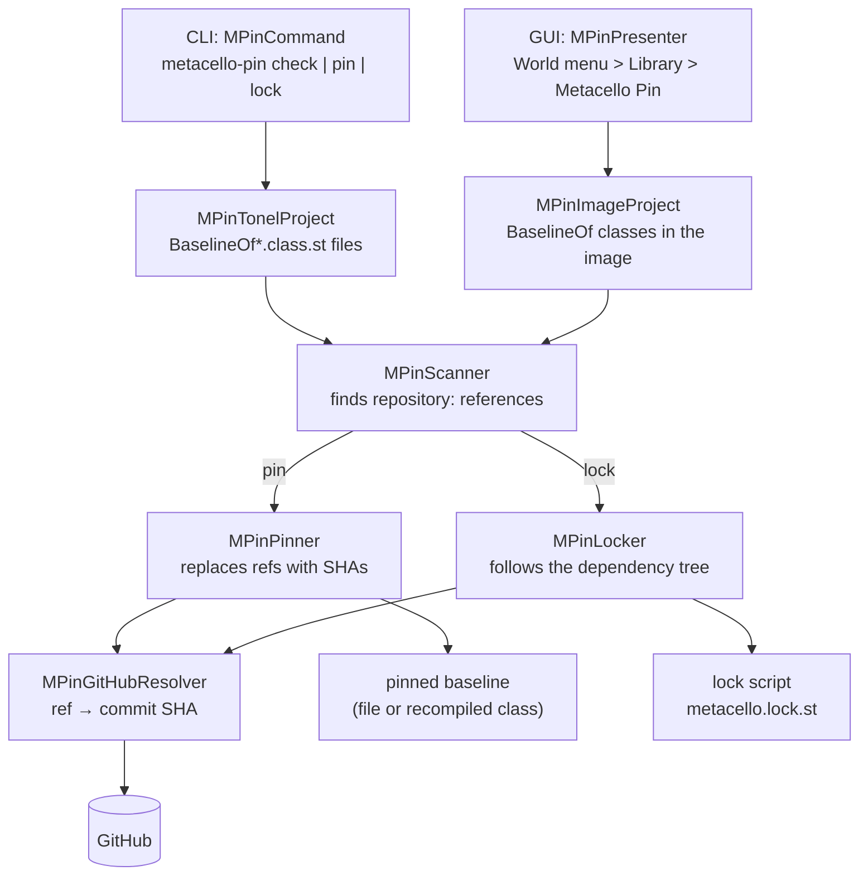
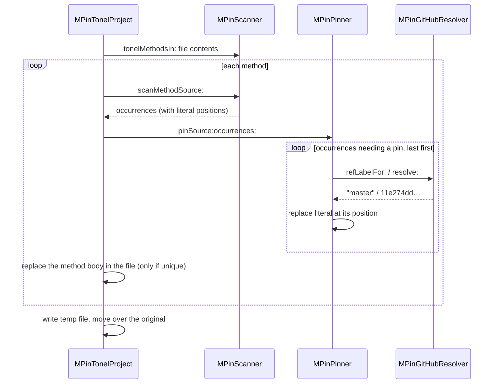

# Architecture

`metacello-pin` reads Metacello baselines and finds every `spec repository: '...'` in them.
For each GitHub reference, it asks GitHub for the commit SHA that the reference points to.
`pin` then writes those SHAs into the baseline. `lock` instead follows the dependencies of
the dependencies and writes a Metacello script that locks all of them. The CLI and the GUI
use the same core classes for this.

## Overview



The diagram reads from top to bottom:

1. The CLI reads Tonel files in a directory, and the GUI reads classes loaded in the image.
   Both sources are subclasses of `MPinProject`, so the rest of the code is the same for
   both.
2. `MPinScanner` finds the `repository:` references in each baseline. The `check` command
   stops here and prints the references.
3. For `pin`, `MPinPinner` rewrites each reference in the baseline. For `lock`,
   `MPinLocker` also downloads the baselines of the dependencies and writes the lock
   script.
4. `MPinPinner` and `MPinLocker` both get commit SHAs from `MPinGitHubResolver`. No other
   class uses the network.

## Packages

| Package | Role |
|---------|------|
| `MetacelloPin-Core` | The data classes, the scanner, the pinner, the locker, the GitHub resolver and the safe Tonel parser |
| `MetacelloPin-CLI` | `MPinCommand`, which runs the commands, and `MPinCommandLineHandler`, the command line entry point on Pharo 12 and 13 |
| `MetacelloPin-Clap` | `MPinClapCommand`, the command line entry point on Pharo 14. Metacello loads this package only on Pharo 14. |
| `MetacelloPin-GUI` | `MPinPresenter`, a Spec2 window |
| `MetacelloPin-Tests` | SUnit tests. They do not use the network (`MPinStubResolver` answers instead of GitHub). |
| `BaselineOfMetacelloPin` | The groups `Core` (core and CLI), `GUI`, `Tests` and `default` (everything) |

The core uses only what a standard Pharo 12, 13 or 14 image already contains: RBParser,
TonelParser, STON and Zinc. The tests pass on Pharo 12.0, 13.1 and 14.0.

## Classes

### Data

| Class | What it holds |
|-------|---------------|
| `MPinReference` | One repository description such as `github://owner/project:ref/path`, split into its parts. It tells whether the ref is already a full 40-character SHA (`isPinned`) and whether every part uses only allowed characters (`isWellFormed`). `pinnedTo: sha` answers the same description with the SHA as the ref. It also answers the path of `BaselineOf<Name>.class.st` inside the repository. |
| `MPinOccurrence` | One `spec repository: '...'` found in a baseline: the method it is in (`location`), the project name and kind (`#baseline`, `#project` or `#package`), and the position of the string in the method. After pinning, it also holds the SHA and the original ref (`resolvedSha`, `refLabel`), or the error (`errorMessage`). It decides whether the reference can be pinned (`isPinnable`, `unsupportedReason`) and builds the new string (`pinnedLiteral`). |
| `MPinLockEntry` | One locked baseline: its name, reference, SHA, original ref and the baseline that required it. It prints its `Metacello new ...; lock.` and `...; load.` statements (`print:on:`). |
| `MPinLockfile` | The result of `lock`: the entries in load order (dependencies first) and the warnings. `script` answers the text of the lock script, and `writeTo:` writes it to a file through a temporary file. The CLI and the GUI both use `writeTo:`. |

### Processing

| Class | What it does |
|-------|--------------|
| `MPinScanner` | It parses each method with `RBParser` and finds the `repository:` sends. For each one, it looks at the enclosing `spec baseline: 'Name' with: [...]` to get the project name. It accepts a method source, a Tonel file or a class in the image. |
| `MPinPinner` | For each occurrence that needs a pin, it gets the SHA from the resolver and replaces the string at its recorded position. It works from the end of the method to the start, so the positions of the earlier strings stay valid. |
| `MPinLocker` | It walks the dependency tree breadth-first and builds an `MPinLockfile` (see [lock](#lock)). |
| `MPinResolver` | The abstract class for resolvers. `resolve:` rejects any answer that is not a SHA. Subclasses implement `resolveSha:`, `defaultBranchOf:` and `fetch:baselineNamed:at:`. |
| `MPinGitHubResolver` | It gets SHAs and default branches from the GitHub REST API, and remote baseline sources from `raw.githubusercontent.com`. It sends `GITHUB_TOKEN` to the API when the variable is set. |
| `MPinSafeTonelParser` / `MPinSafeSTONReader` | They parse Tonel files but refuse to create classes named in the file's metadata (see [security.md](security.md)). |

### Sources of baselines

`MPinProject` has two subclasses. Both answer the same messages: `occurrences`,
`pinWith: aResolver` and `lockWith: aResolver`.

| Class | Reads | `pin` writes |
|-------|-------|--------------|
| `MPinTonelProject` | Every `BaselineOf*.class.st` file below a directory | The file. It rewrites the changed methods, writes a temporary file and moves it over the original. |
| `MPinImageProject` | The methods of one `BaselineOf` subclass in the image | It recompiles each changed method in its protocol. You commit the change with Iceberg. |

## Flows

### check

```
MPinTonelProject occurrences
  └─ for each BaselineOf*.class.st: MPinScanner scanTonelString:
       └─ for each method: RBParser → repository: sends → MPinOccurrence
```

`check` does not use the network. The CLI prints one line for each occurrence and exits
with status 1 if any of them needs a pin.

### pin



Only the string changes. The rest of the method, including its formatting, stays as it was:

```smalltalk
with: [ spec repository: 'github://svenvc/NeoJSON:11e274dd96dc9636cab90929937b7cd09719de7c/repository' "master" ].
```

Running `pin` again changes nothing, because it skips references that are already SHAs.

### lock

`MPinLocker lock:` keeps a queue of occurrences. The queue starts with the occurrences in
your own baseline (the root). For each occurrence it takes from the queue, the locker does
the following:

1. If the reference cannot be pinned, the locker adds a warning and moves on. This is the
   case for non-GitHub repositories, `package:with:`, repositories that are not a string
   literal, and malformed descriptions.
2. If the project is already locked, the locker keeps the first SHA, which is the one
   closest to the root. When the new SHA is different, it adds a `conflict:` warning.
3. Otherwise the locker gets the SHA from the resolver (or uses the SHA that is already in
   the reference) and adds an `MPinLockEntry`.
4. The locker downloads that project's `BaselineOf<Name>.class.st` at the SHA, scans it,
   and adds its occurrences to the queue. Each of them remembers which baseline required
   it (`requiredBy`).

The locker also records which baseline required which. It stops after 500 baselines
(`maxEntries:`). It then sorts the entries so that every dependency comes before the
baselines that need it. If two baselines require each other, the locker breaks the cycle
where it finds it.

The script it writes has two steps:

```smalltalk
"1. Lock every baseline at its commit."
Metacello new
	baseline: 'NeoJSON';
	repository: 'github://svenvc/NeoJSON:11e274dd96dc9636cab90929937b7cd09719de7c/repository' "master, required by root";
	lock.
...
"2. Load them, dependencies first."
Metacello new
	baseline: 'NeoJSON';
	repository: 'github://svenvc/NeoJSON:11e274dd96dc9636cab90929937b7cd09719de7c/repository' "master, required by root";
	load.
...
```

The script needs both steps. In the test described in
[verification.md](verification.md#lock), the root project requires Mid, Mid requires Leaf,
and Mid asks for a different Leaf repository than the one in the lock:

| Script | Result when the root project is loaded afterwards |
|--------|---------------------------------------------------|
| lock only | Metacello prints `Project is locked, skipping.` and does not load Leaf |
| no lock, Leaf loaded first | `MetacelloConflictingProjectError` |
| lock, then load (this script) | Leaf stays at the locked repository; Mid and the root load |

## Front ends

Users work with `metacello-pin` through the CLI or the GUI. Both call the same core
classes.

### CLI

`MPinCommand` reads the command line and runs `check`, `pin` or `lock`. If you give no
directory, it uses `src`.

Pharo reads the command line in a different way in each version, so there are two entry
points. Each one only passes the arguments to `MPinCommand`.

- Pharo 12 and 13 use `MPinCommandLineHandler`. Pharo has its own handler,
  `STCommandLineHandler`, that runs any `.st` file on the command line as a script. The
  file after `--output` ends with `.st`, so `MPinCommandLineHandler` has a higher priority
  (`priority` 1). Pharo then chooses it instead.
- Pharo 14 uses `MPinClapCommand`. In Pharo 14, every command line goes to Clap, and Pharo
  no longer calls `CommandLineHandler` subclasses. Clap accepts `--output file` but not
  `--output=file`. The docs therefore always use `--output file`.

### GUI

`MPinPresenter` has three parts:

- On the left, a list of the `BaselineOf` classes in the image. You can filter it.
- On the right, a table of the `repository:` references in the selected baseline, with
  their status. A status line under the table counts the references by status and says
  what to do next.
- At the bottom, a pane for the lock script.

Pin is enabled only when the baseline has a reference that Pin would change, and Lock only
when the baseline has at least one reference. After Pin, the status line says that only
the image changed and that you need to commit with Iceberg.

The Lock button only shows the script in the pane. The Save... button writes it to a file
that you choose. The label above the pane says whether the script is saved.

The GUI calls GitHub in the UI process. The window does not respond until the calls finish
(see [ROADMAP.md](../ROADMAP.md)).

## Extending

To support another host, such as GitLab or Bitbucket:

1. Write a subclass of `MPinResolver`. It must implement `resolveSha:` (ref to SHA),
   `defaultBranchOf:` and `fetch:baselineNamed:at:` (download a baseline file).
2. Change `MPinOccurrence>>unsupportedReason`. It now rejects every host except GitHub.

To support another spec form, such as `spec package: 'X' with: [ spec repository: ... ]`:
the scanner already records the form of each occurrence (`kind`). Only
`MPinOccurrence>>unsupportedReason` rejects the other forms, so start there.

## Tests

No test uses the network.

- `MPinStubResolver` answers SHAs and remote baseline sources from dictionaries, in place
  of GitHub. `MPinTestFixtures` holds the sample baseline.
- `MPinGitHubResolverTest` runs the real resolver against local `ZnServer`s, set with
  `apiUrl:rawUrl:`.
- `MPinTonelProjectTest` writes to an in-memory file system (`FileSystem memory`).
  `MPinImageProjectTest` uses an anonymous `BaselineOf` subclass.
- `MPinSecurityTest` covers the threats listed in [security.md](security.md).
- `MPinCommandTest` covers how the CLI reads its arguments (`--output file` and
  `--output=file`).
